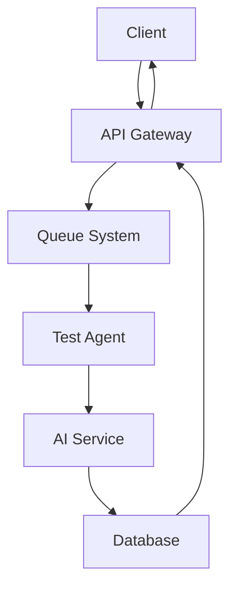

# 🏗️ Архитектура QAI Backend

Обзор архитектуры системы QAI Backend.

## 📋 Содержание

- [**Обзор системы**](#обзор-системы)
- [**Компоненты**](#компоненты)
- [**Схема базы данных**](./database.md)
- [**API дизайн**](./api-design.md)
- [**Безопасность**](#безопасность)

## 🔍 Обзор системы

QAI Backend - это микросервисная архитектура для автоматизированного тестирования веб-приложений с использованием AI.

### Основные принципы
- **Масштабируемость** - горизонтальное масштабирование
- **Надежность** - отказоустойчивость и восстановление
- **Производительность** - асинхронная обработка
- **Безопасность** - защита данных и API

## 🧩 Компоненты

### 1. API Gateway
- **Express.js** сервер
- **RESTful API** endpoints
- **Аутентификация** и авторизация
- **Rate limiting** и валидация

### 2. Queue System
- **BullMQ** для очередей
- **Redis** как брокер сообщений
- **Асинхронная обработка** заданий
- **Retry механизм** для надежности

### 3. Database Layer
- **Supabase** (PostgreSQL)
- **Структурированные данные** тестов
- **JSONB** для гибких схем
- **Индексы** для производительности

### 4. AI Service
- **OpenAI GPT-4o/5** интеграция
- **Анализ DOM** и логов
- **Генерация отчетов** об ошибках
- **Кэширование** результатов

### 5. Test Agents
- **Playwright** агенты
- **Docker** контейнеры
- **Мультибраузерная** поддержка
- **Мобильная** эмуляция

## 🔄 Поток данных

## 🗄️ Схема базы данных

Основные таблицы:
- **tests** - информация о тестах
- **test_results** - результаты выполнения
- **projects** - проекты пользователей
- **users** - пользователи системы
- **credit_transactions** - транзакции кредитов

Подробнее в [схеме базы данных](./database.md).

## 🔐 Безопасность

### Аутентификация
- **JWT токены** для API
- **API ключи** для агентов
- **Rate limiting** по IP и пользователю

### Защита данных
- **HTTPS** обязательно
- **Валидация** всех входных данных
- **Санитизация** пользовательского ввода
- **Логирование** всех операций

### Секреты
- **Environment переменные** для конфигурации
- **Никогда не коммитить** секреты в код
- **Ротация** ключей и токенов

## 📊 Мониторинг

### Метрики
- **Response time** API
- **Queue length** и processing time
- **Database** performance
- **Error rates** по компонентам

### Логирование
- **Structured logging** с Winston
- **Trace ID** для отслеживания запросов
- **Error tracking** и alerting

## 🚀 Масштабирование

### Горизонтальное
- **Load balancer** для API
- **Multiple workers** для очередей
- **Database sharding** при необходимости

### Вертикальное
- **CPU/Memory** оптимизация
- **Database tuning** и индексы
- **Caching** стратегии

---

[← Назад к документации](../README.md) | [Схема БД →](./database.md)
