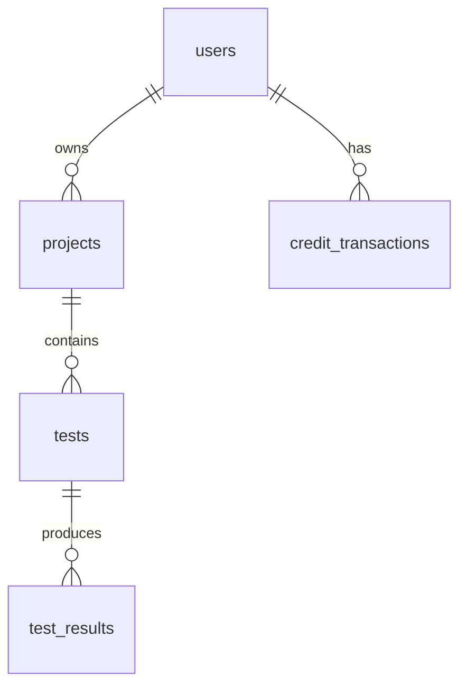

# 🗄️ Схема базы данных

Детальная схема базы данных QAI Backend.

## 📋 Содержание

- [**Обзор таблиц**](#обзор-таблиц)
- [**Связи**](#связи)
- [**Индексы**](#индексы)
- [**Миграции**](#миграции)

## 🗂️ Обзор таблиц

### `tests` - Основная таблица тестов

```sql
CREATE TABLE tests (
  id UUID PRIMARY KEY DEFAULT gen_random_uuid(),
  url TEXT NOT NULL,
  status TEXT NOT NULL DEFAULT 'pending',
  browsers TEXT[] NOT NULL,
  project_id UUID NOT NULL,
  user_id UUID,
  options JSONB,
  created_at TIMESTAMP DEFAULT NOW(),
  updated_at TIMESTAMP DEFAULT NOW(),
  started_at TIMESTAMP,
  completed_at TIMESTAMP
);
```

**Поля:**
- `id` - уникальный идентификатор теста
- `url` - URL для тестирования
- `status` - статус теста (pending, running, completed, failed)
- `browsers` - массив браузеров для тестирования
- `project_id` - ссылка на проект
- `user_id` - владелец теста (опционально)
- `options` - дополнительные настройки теста
- `created_at` - время создания
- `updated_at` - время последнего обновления
- `started_at` - время начала выполнения
- `completed_at` - время завершения

### `test_results` - Результаты тестов

```sql
CREATE TABLE test_results (
  id UUID PRIMARY KEY DEFAULT gen_random_uuid(),
  test_id UUID NOT NULL REFERENCES tests(id),
  browser TEXT NOT NULL,
  status TEXT NOT NULL,
  screenshot TEXT,
  dom TEXT,
  logs TEXT,
  network_logs JSONB,
  errors JSONB,
  performance JSONB,
  ai_summary JSONB,
  created_at TIMESTAMP DEFAULT NOW(),
  completed_at TIMESTAMP
);
```

**Поля:**
- `id` - уникальный идентификатор результата
- `test_id` - ссылка на тест
- `browser` - браузер, в котором выполнялся тест
- `status` - статус выполнения (completed, failed, timeout)
- `screenshot` - base64 скриншот страницы
- `dom` - DOM структура страницы
- `logs` - логи консоли браузера
- `network_logs` - сетевые запросы
- `errors` - ошибки JavaScript
- `performance` - метрики производительности
- `ai_summary` - анализ AI с найденными багами

### `projects` - Проекты пользователей

```sql
CREATE TABLE projects (
  id UUID PRIMARY KEY DEFAULT gen_random_uuid(),
  name TEXT NOT NULL,
  description TEXT,
  user_id UUID NOT NULL,
  settings JSONB,
  created_at TIMESTAMP DEFAULT NOW(),
  updated_at TIMESTAMP DEFAULT NOW()
);
```

### `users` - Пользователи системы

```sql
CREATE TABLE users (
  id UUID PRIMARY KEY DEFAULT gen_random_uuid(),
  email TEXT UNIQUE NOT NULL,
  name TEXT,
  credits INTEGER DEFAULT 0,
  subscription_plan TEXT,
  created_at TIMESTAMP DEFAULT NOW(),
  updated_at TIMESTAMP DEFAULT NOW()
);
```

### `credit_transactions` - Транзакции кредитов

```sql
CREATE TABLE credit_transactions (
  id UUID PRIMARY KEY DEFAULT gen_random_uuid(),
  user_id UUID NOT NULL REFERENCES users(id),
  amount INTEGER NOT NULL,
  type TEXT NOT NULL,
  description TEXT,
  created_at TIMESTAMP DEFAULT NOW()
);
```

## 🔗 Связи

### Основные связи



### Foreign Keys

- `tests.project_id` → `projects.id`
- `tests.user_id` → `users.id`
- `test_results.test_id` → `tests.id`
- `projects.user_id` → `users.id`
- `credit_transactions.user_id` → `users.id`

## 📊 Индексы

### Производительность

```sql
-- Индексы для tests
CREATE INDEX idx_tests_status ON tests(status);
CREATE INDEX idx_tests_project_id ON tests(project_id);
CREATE INDEX idx_tests_user_id ON tests(user_id);
CREATE INDEX idx_tests_created_at ON tests(created_at DESC);

-- Индексы для test_results
CREATE INDEX idx_test_results_test_id ON test_results(test_id);
CREATE INDEX idx_test_results_browser ON test_results(browser);
CREATE INDEX idx_test_results_status ON test_results(status);

-- Индексы для users
CREATE INDEX idx_users_email ON users(email);

-- Индексы для projects
CREATE INDEX idx_projects_user_id ON projects(user_id);

-- Индексы для credit_transactions
CREATE INDEX idx_credit_transactions_user_id ON credit_transactions(user_id);
CREATE INDEX idx_credit_transactions_created_at ON credit_transactions(created_at DESC);
```

### JSONB индексы

```sql
-- Для поиска по options в tests
CREATE INDEX idx_tests_options_gin ON tests USING GIN (options);

-- Для поиска по ai_summary в test_results
CREATE INDEX idx_test_results_ai_summary_gin ON test_results USING GIN (ai_summary);
```

## 🔄 Миграции

### Создание таблиц

```sql
-- Создание всех таблиц
\i supabase-schema.sql
```

### Обновление схемы

```sql
-- Добавление новых полей
ALTER TABLE tests ADD COLUMN priority INTEGER DEFAULT 1;

-- Создание новых индексов
CREATE INDEX idx_tests_priority ON tests(priority);
```

## 📈 Оптимизация

### Рекомендации

1. **Партиционирование** по дате для больших таблиц
2. **Архивирование** старых результатов
3. **Сжатие** JSONB полей
4. **Мониторинг** производительности запросов

### Мониторинг

```sql
-- Топ медленных запросов
SELECT query, mean_time, calls
FROM pg_stat_statements
ORDER BY mean_time DESC
LIMIT 10;

-- Размер таблиц
SELECT
  schemaname,
  tablename,
  pg_size_pretty(pg_total_relation_size(schemaname||'.'||tablename)) as size
FROM pg_tables
WHERE schemaname = 'public'
ORDER BY pg_total_relation_size(schemaname||'.'||tablename) DESC;
```

---

[← Назад к архитектуре](./README.md) | [API дизайн →](./api-design.md)
