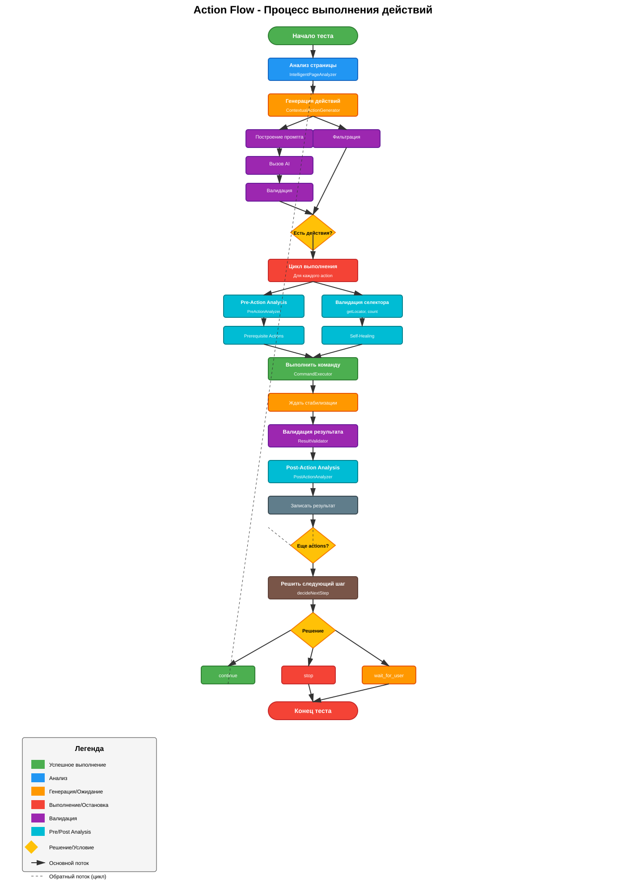
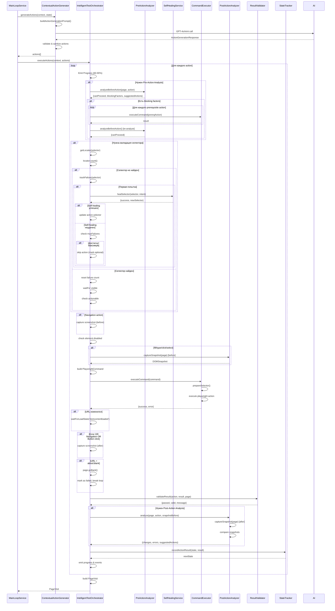

# Action Flow - Процесс выполнения действий во время тестирования

## Полный flow выполнения actions

```mermaid
flowchart TD
    Start([Начало теста]) --> AnalyzePage[Анализ страницы<br/>IntelligentPageAnalyzer]
    AnalyzePage --> GenerateActions[Генерация действий<br/>ContextualActionGenerator.generateActions]

    GenerateActions --> BuildPrompt[Построение промпта<br/>buildActionGenerationPrompt]
    BuildPrompt --> CallAI[Вызов AI<br/>GPT-4o или mini]
    CallAI --> ValidateResponse[Валидация ответа<br/>Zod schema]
    ValidateResponse --> SanitizeActions[Санатизация действий<br/>validate, fix selectors]
    SanitizeActions --> FilterSafe[Фильтрация безопасных<br/>SafetyGuard.checkAction]
    FilterSafe --> HasActions{Есть действия?}

    HasActions -->|Нет| DecideEmpty[decideNextStep<br/>Что делать?]
    DecideEmpty --> StopEmpty[Остановка или продолжение]

    HasActions -->|Да| ExecuteLoop[Цикл выполнения<br/>для каждого action]

    ExecuteLoop --> EmitProgress1[Emit Progress 60-90%]
    EmitProgress1 --> PreActionCheck{Нужен<br/>Pre-Action<br/>Analysis?}

    PreActionCheck -->|Да| PreActionAnalysis[PreActionAnalyzer<br/>analyzeBeforeAction]
    PreActionAnalysis --> CanProceed{Можно<br/>продолжить?}

    CanProceed -->|Нет| ExecutePrereq[Выполнить<br/>prerequisite actions]
    ExecutePrereq --> ReAnalyze[Повторный анализ]
    ReAnalyze --> CanProceed

    CanProceed -->|Да| ValidateSelector{Нужна<br/>валидация<br/>селектора?}
    PreActionCheck -->|Нет| ValidateSelector

    ValidateSelector -->|Да| CheckSelector[Проверка селектора<br/>getLocator, count]
    CheckSelector --> SelectorFound{Селектор<br/>найден?}

    SelectorFound -->|Нет| TrackFailure[Отследить failure<br/>selectorFailures++]
    TrackFailure --> TryHealing{Первая<br/>попытка?}

    TryHealing -->|Да| SelfHealing[Self-Healing<br/>SelfHealingService]
    SelfHealing --> HealingSuccess{Успешно?}

    HealingSuccess -->|Да| UpdateSelector[Обновить selector<br/>в action]
    HealingSuccess -->|Нет| CheckMaxFailures{Достигнут<br/>максимум<br/>failures?}
    TryHealing -->|Нет| CheckMaxFailures

    CheckMaxFailures -->|Да| SkipAction[Пропустить action<br/>mark as optional]
    CheckMaxFailures -->|Нет| SkipAction
    UpdateSelector --> CheckVisibility
    SelectorFound -->|Да| ResetFailures[Сбросить счетчик<br/>failures]
    ResetFailures --> CheckVisibility

    CheckVisibility --> CheckVisibility[Проверка видимости<br/>waitFor visible]
    CheckVisibility --> CheckActionable[Проверка actionable<br/>elementFromPoint]
    CheckActionable --> CheckScreenshot{Нужен<br/>before<br/>screenshot?}

    CheckScreenshot -->|Да Navigation| CaptureBefore[Сделать screenshot<br/>before action]
    CheckScreenshot -->|Нет| CheckDisabled
    CaptureBefore --> CheckDisabled

    CheckDisabled --> CheckDisabled[Проверка disabled<br/>getElementDisabledContext]
    CheckDisabled --> CaptureSnapshot{Нужен<br/>DOM snapshot?}

    CaptureSnapshot -->|Да fill/type/click| CaptureDOM[Захватить DOM<br/>snapshot before]
    CaptureSnapshot -->|Нет| BuildCommand
    CaptureDOM --> BuildCommand

    BuildCommand[Построить PlaywrightCommand<br/>convertActionToCommand] --> ExecuteCommand[Выполнить команду<br/>CommandExecutor.executeCommand]

    ExecuteCommand --> CheckURLChanged{URL<br/>изменился?}
    CheckURLChanged -->|Да| WaitStabilize[Ждать стабилизации<br/>waitForLoadState]
    CheckURLChanged -->|Нет| CheckAfterScreenshot
    WaitStabilize --> CheckAfterScreenshot

    CheckAfterScreenshot{Нужен<br/>after<br/>screenshot?}
    CheckAfterScreenshot -->|Да Error/Nav/Click| CaptureAfter[Сделать screenshot<br/>after action]
    CheckAfterScreenshot -->|Нет| CheckAboutBlank
    CaptureAfter --> CheckAboutBlank

    CheckAboutBlank{URL =<br/>about:blank?}
    CheckAboutBlank -->|Да| GoBack[Попытка goBack<br/>от about:blank]
    GoBack --> MarkFailed[Пометить как failed<br/>остановить выполнение]
    CheckAboutBlank -->|Нет| ValidateResult

    ValidateResult[Валидация результата<br/>ResultValidator.validateResult] --> PostActionAnalysis{Нужен<br/>Post-Action<br/>Analysis?}

    PostActionAnalysis -->|Да| PostAnalysis[PostActionAnalyzer.analyze<br/>сравнение DOM snapshots]
    PostAnalysis --> PostDecision{Есть<br/>suggested<br/>actions?}

    PostDecision -->|Да| LogSuggestions[Логировать<br/>suggestions]
    PostDecision -->|Нет| RecordResult
    LogSuggestions --> RecordResult
    PostActionAnalysis -->|Нет| RecordResult

    RecordResult[Записать результат<br/>StateTracker.recordActionResult] --> EmitProgress2[Emit Progress<br/>обновление]
    EmitProgress2 --> EmitEvent[Emit event<br/>action_completed/failed]
    EmitEvent --> MoreActions{Есть еще<br/>actions?}

    MoreActions -->|Да| ExecuteLoop
    MoreActions -->|Нет| BuildPageVisit[Построить PageVisit<br/>с результатами]

    BuildPageVisit --> RecordVisit[Записать visit<br/>StateTracker.recordPageVisit]
    RecordVisit --> DecideNextStep[Решить следующий шаг<br/>decideNextStep]

    DecideNextStep --> Decision{Решение}
    Decision -->|continue| AnalyzePage
    Decision -->|stop| End([Конец теста])
    Decision -->|wait_for_user| WaitUser[Ждать ответа<br/>пользователя]
    Decision -->|retry| Retry[Повторить<br/>текущую страницу]
    Decision -->|skip| SkipPage[Пропустить<br/>страницу]

    WaitUser --> UserResponse{Ответ<br/>получен?}
    UserResponse -->|Да| AnalyzePage
    UserResponse -->|Timeout| Timeout[Timeout<br/>остановка]
    Timeout --> End
    Retry --> AnalyzePage
    SkipPage --> AnalyzePage
    StopEmpty --> End
    MarkFailed --> End
    SkipAction --> MoreActions
```

## Детальный flow для одного action

## Компоненты и их роли

### 1. ContextualActionGenerator

- **Генерация действий**: Создает DynamicAction[] на основе анализа страницы
- **Промпт**: buildActionGenerationPrompt
- **Валидация**: Zod schema (ActionGenerationResponseSchema)
- **Санатизация**: Проверка типов, селекторов, required fields

### 2. PreActionAnalyzer

- **Анализ до действия**: Проверяет можно ли выполнить action
- **Blocking factors**: Элемент не существует, не видим, не actionable, disabled
- **Prerequisite actions**: Генерирует действия для устранения блокировок
- **Пример**: Если нужно заполнить required field перед submit

### 3. SelfHealingService

- **Восстановление селекторов**: Если селектор не найден, пытается найти альтернативу
- **Режим**: fast (быстрый поиск)
- **Результат**: Новый селектор или failure

### 4. CommandExecutor

- **Выполнение команд**: Преобразует DynamicAction в PlaywrightCommand
- **Нормализация**: prepareSelector() - нормализует селектор один раз
- **Таймауты**: Адаптивные таймауты через AdaptiveConfigService
- **Результат**: {success, error}

### 5. PostActionAnalyzer

- **Анализ после действия**: Сравнивает DOM до и после
- **Обнаружение изменений**: Новые элементы, ошибки, модалки
- **Предложения**: Suggested actions для следующих шагов

### 6. ResultValidator

- **Валидация результата**: Проверяет соответствует ли результат ожиданиям
- **Проверки**: visible, text, value, url, count, enabled/disabled
- **Результат**: {passed, valid, message}

### 7. StateTracker

- **Отслеживание состояния**: Записывает результаты действий и визиты страниц
- **История**: completedActions, pagesAnalyzed, errors
- **Циклы**: Обнаруживает URL cycles

## Ключевые точки оптимизации

1. **Screenshots**: Только когда нужно (navigation, errors, button clicks)
2. **DOM Snapshots**: Только для fill/type/click/select
3. **Selector Validation**: Только если требуется (через AdaptiveConfigService)
4. **Self-Healing**: Только на первой попытке
5. **Prerequisite Actions**: Только если есть blocking factors
6. **Post-Action Analysis**: Только для определенных типов действий

## Обработка ошибок

1. **Selector not found**: Self-healing → track failure → skip if max failures
2. **Element disabled**: Log context → continue (AI адаптируется в следующей итерации)
3. **about:blank redirect**: goBack() → mark failed → break loop
4. **Validation failed**: Mark action as failed, continue with next action
5. **Prerequisite failed**: Re-analyze → skip if still blocked
