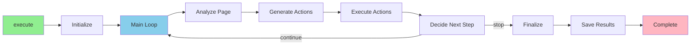
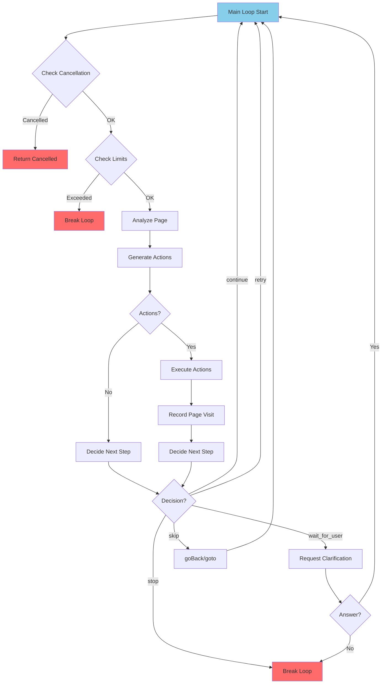
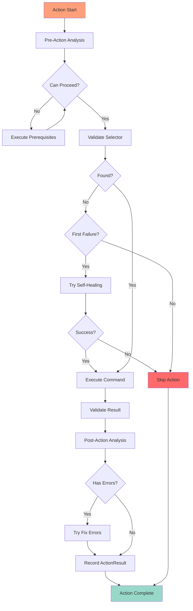
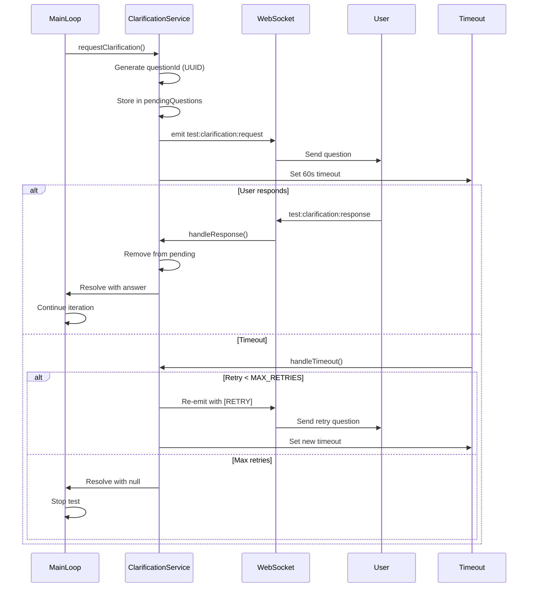
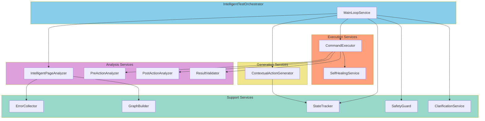

# Intelligent Test Execution Flow - Visual Diagram

**📊 SVG Diagram:** См. [INTELLIGENT_TEST_EXECUTION_FLOW.svg](./INTELLIGENT_TEST_EXECUTION_FLOW.svg) для статической SVG диаграммы.

## Mermaid Flow Diagram

```mermaid
flowchart TD
    Start([executePlaywrightTest]) --> Init[PHASE 1: INITIALIZATION]

    Init --> Init1[1.1 Setup Abort Handling]
    Init1 --> Init2[1.2 Initialize CommandExecutor]
    Init2 --> Init3[1.3 Setup Navigation Listeners]
    Init3 --> Init4[1.4 Verify Initial URL]
    Init4 --> Init5{about:blank?}
    Init5 -->|Yes| TryNav[Try Navigate to startUrl]
    TryNav --> StillBlank{Still blank?}
    StillBlank -->|Yes| Fail1[Return Failed Result]
    StillBlank -->|No| Init6
    Init5 -->|No| Init6[1.5 Initialize State]
    Init6 --> Init7[1.6 Initialize Services<br/>ErrorCollector, GraphBuilder, CostManager]
    Init7 --> Init8[1.7 Execute Custom Scripts]
    Init8 --> Init9[1.8 Wait for Selector]
    Init9 --> Init10[1.9 Emit Progress 30%]
    Init10 --> MainLoop[PHASE 2: MAIN LOOP]

    MainLoop --> LoopStart[Iteration Start]
    LoopStart --> CheckCancel{Test Cancelled?}
    CheckCancel -->|Yes| Cancelled[Return Cancelled]
    CheckCancel -->|No| CheckLimits[Check Limits SafetyGuard]
    CheckLimits --> LimitsOK{Limits OK?}
    LimitsOK -->|No| BreakLoop[Break Loop]
    LimitsOK -->|Yes| Step1[STEP 1: ANALYZE PAGE]

    Step1 --> Analyze1[1.1 Wait for SPA Load]
    Analyze1 --> Analyze2[1.2 Parallel: Modal Check + DOM Analysis]
    Analyze2 --> Analyze3[1.3 Handle Modals]
    Analyze3 --> Analyze4[1.4 Capture Screenshot]
    Analyze4 --> Analyze5[1.5 Enhance DOM with AI Selectors]
    Analyze5 --> VisionNeeded{Vision Needed?}
    VisionNeeded -->|Yes| VisionParallel[1.7 Parallel: Vision + Logic Analysis]
    VisionNeeded -->|No| DOMOnly[1.7 DOM-only + Logic Analysis]
    VisionParallel --> MatchVision[1.8 Match Vision Elements with DOM]
    MatchVision --> EnhanceModals[1.9 Enhance DOM with Vision Modals]
    EnhanceModals --> ReRunLogic[1.10 Re-run Logic with Vision Data]
    DOMOnly --> BuildContext
    ReRunLogic --> BuildContext[1.11 Build PageContext]
    BuildContext --> AddPageNode[1.12 Add Page Node to Graph]
    AddPageNode --> CheckEmpty{Empty Page?}
    CheckEmpty -->|Yes| EmptyDecision[decideNextStep]
    EmptyDecision --> EmptyAction{Action?}
    EmptyAction -->|stop| BreakLoop
    EmptyAction -->|skip| GoBack[goBack or goto startUrl]
    GoBack --> LoopStart
    EmptyAction -->|continue| CheckCycle
    CheckEmpty -->|No| CheckCycle[1.14 Check URL Cycles]
    CheckCycle --> CycleDetected{Cycle?}
    CycleDetected -->|Yes| CycleDecision[decideNextStep]
    CycleDecision --> CycleAction{Action?}
    CycleAction -->|stop| BreakLoop
    CycleAction -->|skip| GoBack
    CycleAction -->|continue| CheckPatterns
    CycleDetected -->|No| CheckPatterns[1.15 Check Action Patterns]
    CheckPatterns --> PatternCritical{Critical Pattern?}
    PatternCritical -->|Yes| BreakLoop
    PatternCritical -->|No| Step2[STEP 2: GENERATE ACTIONS]

    Step2 --> Gen1[2.1 Emit Progress 55%]
    Gen1 --> Gen2[2.2 ContextualActionGenerator<br/>Build Prompt + Call GPT-4o-mini]
    Gen2 --> Gen3[2.3 Validate & Sanitize Actions]
    Gen3 --> Gen4[2.4 Filter Safe Actions]
    Gen4 --> Gen5[2.5 Emit Progress 60%]
    Gen5 --> HasActions{Actions Generated?}
    HasActions -->|No| NoActionsDecision[decideNextStep]
    NoActionsDecision --> NoActionsAction{Action?}
    NoActionsAction -->|continue| LoopStart
    NoActionsAction -->|stop| BreakLoop
    HasActions -->|Yes| Step3[STEP 3: EXECUTE ACTIONS]

    Step3 --> Exec1[3.1 Set Total Actions]
    Exec1 --> ExecLoop[FOR each action]
    ExecLoop --> Exec2[3.2.1 Emit Progress 60-90%]
    Exec2 --> Exec3[3.2.2 Pre-Action Analysis]
    Exec3 --> CanProceed{Can Proceed?}
    CanProceed -->|No| PrereqActions[Execute Prerequisites]
    PrereqActions --> CanProceed
    CanProceed -->|Yes| Exec4[3.2.3 Validate Selector]
    Exec4 --> SelectorFound{Selector Found?}
    SelectorFound -->|No| SelfHeal{First Failure?}
    SelfHeal -->|Yes| TryHeal[Try Self-Healing]
    TryHeal --> HealSuccess{Healing Success?}
    HealSuccess -->|Yes| Exec5
    HealSuccess -->|No| CheckFailures[Check Failure Threshold]
    SelfHeal -->|No| CheckFailures
    CheckFailures --> TooManyFailures{Too Many?}
    TooManyFailures -->|Yes| SkipAction[Mark Optional, Skip]
    TooManyFailures -->|No| SkipAction
    SelectorFound -->|Yes| Exec5[3.2.4 Capture Before Screenshot]
    SkipAction --> NextAction{More Actions?}
    Exec5 --> Exec6[3.2.5 Check Element Disabled]
    Exec6 --> Exec7[3.2.6 Capture DOM Snapshot]
    Exec7 --> Exec8[3.2.7 Execute Command]
    Exec8 --> Exec9[3.2.8 Wait for Stabilization]
    Exec9 --> Exec10[3.2.9 Capture After Screenshot]
    Exec10 --> CheckBlank{about:blank?}
    CheckBlank -->|Yes| TryGoBack[Try goBack]
    TryGoBack --> MarkFailed[Mark Action Failed, Break]
    CheckBlank -->|No| Exec11[3.2.11 Validate Result]
    Exec11 --> Exec12[3.2.12 Create ActionResult]
    Exec12 --> Exec13[3.2.13 Post-Action Analysis]
    Exec13 --> HasErrors{Has Errors?}
    HasErrors -->|Yes| TryFix[Try Fix Validation Errors]
    TryFix --> Exec14
    HasErrors -->|No| Exec14[3.2.14 Post-Action AI Analysis]
    Exec14 --> Exec15[3.2.15 Record ActionResult]
    Exec15 --> Exec16[3.2.16 Emit Progress Update]
    Exec16 --> Exec17[3.2.17 Handle Conditional Fields]
    Exec17 --> Exec18[3.2.18 Update State]
    Exec18 --> Exec19[3.2.19 Add Action Edge to Graph]
    Exec19 --> Exec20[3.2.20 Emit Graph Update]
    Exec20 --> NextAction
    MarkFailed --> NextAction
    NextAction -->|Yes| ExecLoop
    NextAction -->|No| Step4[STEP 4: RECORD PAGE VISIT]

    Step4 --> RecordVisit[StateTracker.recordPageVisit]
    RecordVisit --> Step5[STEP 5: DECIDE NEXT STEP]

    Step5 --> Decide1[5.1 Build Decision Prompt]
    Decide1 --> Decide2[5.2 Call GPT-4o-mini]
    Decide2 --> Decision{Decision Type?}
    Decision -->|stop| BreakLoop
    Decision -->|wait_for_user| Clarify[Request Clarification]
    Clarify --> ClarifyWait[Wait 60s for Response]
    ClarifyWait --> ClarifyAnswer{Answer Received?}
    ClarifyAnswer -->|Yes| ClarifyRetry{Retry?}
    ClarifyRetry -->|Yes| ClarifyWait
    ClarifyRetry -->|No| LoopStart
    ClarifyAnswer -->|No| BreakLoop
    Decision -->|skip| SkipAction2[goBack or goto startUrl]
    SkipAction2 --> LoopStart
    Decision -->|retry| LoopStart
    Decision -->|continue| LoopStart

    BreakLoop --> Finalize[PHASE 3: FINALIZATION]
    Cancelled --> Finalize

    Finalize --> Final1[3.1 Check Cancellation]
    Final1 --> WasCancelled{Was Cancelled?}
    WasCancelled -->|Yes| BuildCancelled[buildCancelledResult]
    WasCancelled -->|No| BuildResult[3.2 Build Result]
    BuildCancelled --> Final3
    BuildResult --> Final2[3.2.1-3.2.7 Build Complete Result]
    Final2 --> Final3[3.3 Validate Test Result]
    Final3 --> Final4[3.4 Emit Progress 100%]
    Final4 --> Final5[3.5 Emit Final Event]
    Final5 --> Final6[3.6 Cleanup]
    Final6 --> Final7[3.7 Return IntelligentTestResult]

    Final7 --> Save[PHASE 4: SAVE RESULTS]
    Save --> Save1[4.1 Save Test Session to DB]
    Save1 --> Save2[4.2 Upload Screenshots]
    Save2 --> Save3[4.3 Collect Artifacts]
    Save3 --> Save4[4.4 Upload Artifacts]
    Save4 --> Save5[4.5 Format Result]
    Save5 --> End([COMPLETE])

    Fail1 --> End

    style Start fill:#90EE90
    style End fill:#FFB6C1
    style MainLoop fill:#87CEEB
    style Step1 fill:#DDA0DD
    style Step2 fill:#F0E68C
    style Step3 fill:#FFA07A
    style Step4 fill:#98D8C8
    style Step5 fill:#FFD700
    style Finalize fill:#FF6347
    style Save fill:#20B2AA
    style BreakLoop fill:#FF6B6B
    style Cancelled fill:#FF6B6B
    style Fail1 fill:#FF6B6B
```

## Simplified High-Level Flow

## Main Loop Detail

## Action Execution Detail

## Clarification Flow

## Component Interactions

