# Intelligent Testing Action Flow

## Complete Action Flow Diagram

```mermaid
flowchart TD
    Start([🚀 Test Execution Starts]) --> Execute[IntelligentTestOrchestrator.execute<br/>🔵 Core Orchestrator]

    Execute --> Setup[Setup Phase<br/>🔵 Initialize Services]
    Setup --> MainLoop[MainLoopService.execute<br/>🔵 Main Loop]

    MainLoop --> LoopStart{🔄 Main Loop Iteration}

    LoopStart --> AnalyzePage[analyzePage<br/>🔵 Page Analysis]
    AnalyzePage --> PageAnalyzer[IntelligentPageAnalyzer.analyzePage<br/>🔵 Page Analyzer]

    PageAnalyzer --> WaitSPA[waitForSPALoad<br/>🔵 Wait SPA]
    WaitSPA --> CaptureScreenshot[captureScreenshot<br/>🔵 Screenshot]
    CaptureScreenshot --> WaitModals[waitForModals<br/>🔵 Wait Modals]
    WaitModals --> AnalyzeDOM[analyzeDOMFull<br/>🔵 DOM Analysis]
    AnalyzeDOM --> EnhanceDOM[enhanceDOMWithAISelectors<br/>🔵 Enhance DOM]
    EnhanceDOM --> VisionCheck{Should Use Vision?}

    VisionCheck -->|Yes| AnalyzeVision[analyzeWithVision<br/>🔴 Enhanced Prompt]
    VisionCheck -->|No| AnalyzeWithoutVision[analyzeWithoutVision<br/>🔵 Fallback]

    AnalyzeVision --> MatchVision[matchVisionElementsWithDOMSelectors<br/>🔵 Match Elements]
    AnalyzeWithoutVision --> MatchVision
    MatchVision --> EnhanceModals[enhanceDOMWithVisionModals<br/>🔵 Enhance Modals]
    EnhanceModals --> AnalyzeLogic[analyzeLogic<br/>🔵 Logic Analysis]
    AnalyzeLogic --> BuildContext[Build PageContext<br/>🔵 Context Builder]

    BuildContext --> GenerateActions[generateActions<br/>🔵 Generate Actions]
    GenerateActions --> ActionGenerator[ContextualActionGenerator.generateActions<br/>🔵 Action Generator]

    ActionGenerator --> ValidateCache[validateCachedActions<br/>🔵 Validate Cache]
    ValidateCache --> BuildHistory[buildHistorySummary<br/>🔵 Build History]
    BuildHistory --> BuildElements[buildElementsSummary<br/>🔵 Build Elements]
    BuildElements --> BuildDOM[buildDOMSummary<br/>🔵 Build DOM]
    BuildDOM --> GetHTML[getPageHTML<br/>🔵 Get HTML]
    GetHTML --> MaskPII[maskPII<br/>🔴 Enhanced PII Masking]
    MaskPII --> ParseJSON[parseRobustJSON<br/>🔴 Enhanced JSON Parsing]
    ParseJSON --> Sanitize[sanitizeActions<br/>🔵 Sanitize]
    Sanitize --> ReturnActions[Return Actions<br/>🔵 Return]

    ReturnActions --> ExecuteActions[executeActions<br/>🟡 Refactored]
    ExecuteActions --> ExecuteSingle[executeSingleAction<br/>🟢 NEW: Main Action Orchestrator]

    ExecuteSingle --> PreAnalysis[handlePreActionAnalysis<br/>🟢 NEW: Pre-Action Handler]
    PreAnalysis --> PreActionAnalyzer[PreActionAnalyzer.analyzeBeforeAction<br/>🔵 Pre-Action Analyzer]
    PreActionAnalyzer --> LogPrereq[logPrerequisiteAction<br/>🟢 NEW: Logging Helper]
    LogPrereq --> ValidateSelector[validateAndPrepareSelector<br/>🟢 NEW: Selector Validator]
    ValidateSelector --> SelfHealing[SelfHealingService.healSelector<br/>🔵 Self-Healing]
    SelfHealing --> CaptureBefore[captureActionScreenshots<br/>🟢 NEW: Screenshot Helper]
    CaptureBefore --> ExecuteCommand[executeActionCommand<br/>🟢 NEW: Command Executor]

    ExecuteCommand --> LogExecution[logActionExecution<br/>🟢 NEW: Logging Helper]
    LogExecution --> CommandExec[CommandExecutor.executeCommand<br/>🔵 Command Executor]
    CommandExec --> WaitEffect[waitForActionEffect<br/>🟢 NEW: Wait Effect]
    WaitEffect --> HandleAsync[handleAsyncOperations<br/>🟢 NEW: Async Handler]
    HandleAsync --> EnsureComplete[ensureActionCompleted<br/>🟢 NEW: Ensure Complete]
    EnsureComplete --> VerifySuccess[verifyActionSuccess<br/>🟢 NEW: Verify Success]
    VerifySuccess --> CaptureAfter[captureActionScreenshots<br/>🟢 NEW: Screenshot Helper]

    CaptureAfter --> ValidateResult[ResultValidator.validateResult<br/>🔵 Result Validator]
    ValidateResult --> PostAnalysis[handlePostActionAnalysisMethod<br/>🟢 NEW: Post-Action Handler]
    PostAnalysis --> PostActionAnalyzer[PostActionAnalyzer.analyze<br/>🔵 Post-Action Analyzer]
    PostActionAnalyzer --> LogPost[logPostActionAnalysis<br/>🟢 NEW: Logging Helper]

    PostAnalysis --> CheckState[checkElementStateAfterAction<br/>🟢 NEW: Check State]
    CheckState --> DetectChanges[detectPageChanges<br/>🟢 NEW: Detect Changes]
    DetectChanges --> HandleError{Action Failed?}

    HandleError -->|Yes| HandleFailure[handleActionFailure<br/>🟢 NEW: Failure Handler]
    HandleFailure --> CreateErrorCtx[createActionErrorContext<br/>🟢 NEW: Error Context]
    CreateErrorCtx --> LogError[logActionError<br/>🟢 NEW: Logging Helper]
    LogError --> ShouldRetry{shouldRetryAction?<br/>🟢 NEW: Retry Check}
    ShouldRetry -->|Yes| ExecuteSingle
    ShouldRetry -->|No| NextAction

    HandleError -->|No| NextAction[Next Action<br/>🔵 Next]
    NextAction --> DecideNext[decideNextStep<br/>🔵 Decide Next]
    DecideNext --> ContextualDecide[ContextualActionGenerator.decideNextStep<br/>🔵 Contextual Decide]
    ContextualDecide --> ParseDecision[parseRobustJSON<br/>🔴 Enhanced JSON Parsing]
    ParseDecision --> DecisionCheck{Decision Type}

    DecisionCheck -->|continue| LoopStart
    DecisionCheck -->|stop| BuildResult[buildResult<br/>🔵 Build Result]
    DecisionCheck -->|wait_for_user| WaitUser[Wait for User<br/>🔵 Wait]
    DecisionCheck -->|retry| RetryAction[Retry Action<br/>🔵 Retry]
    DecisionCheck -->|skip| SkipAction[Skip Action<br/>🔵 Skip]

    RetryAction --> ExecuteSingle
    SkipAction --> NextAction
    WaitUser --> BuildResult

    BuildResult --> ValidateTest[validateTestResult<br/>🔵 Validate Test]
    ValidateTest --> BuildSummary[buildSummary<br/>🔵 Build Summary]
    BuildSummary --> UploadGraph[uploadGraphScreenshotsToStorage<br/>🔵 Upload Graph]
    UploadGraph --> End([✅ Test Complete])

    %% Styling
    style Execute fill:#e1f5ff,stroke:#01579b,stroke-width:2px
    style ExecuteSingle fill:#fff4e1,stroke:#e65100,stroke-width:3px
    style PreAnalysis fill:#fff4e1,stroke:#e65100,stroke-width:3px
    style ValidateSelector fill:#fff4e1,stroke:#e65100,stroke-width:3px
    style ExecuteCommand fill:#fff4e1,stroke:#e65100,stroke-width:3px
    style VerifySuccess fill:#fff4e1,stroke:#e65100,stroke-width:3px
    style PostAnalysis fill:#fff4e1,stroke:#e65100,stroke-width:3px
    style HandleFailure fill:#fff4e1,stroke:#e65100,stroke-width:3px
    style ExecuteActions fill:#fff4e1,stroke:#e65100,stroke-width:3px

    style LogExecution fill:#e8f5e9,stroke:#2e7d32,stroke-width:2px
    style LogError fill:#e8f5e9,stroke:#2e7d32,stroke-width:2px
    style LogPrereq fill:#e8f5e9,stroke:#2e7d32,stroke-width:2px
    style LogPost fill:#e8f5e9,stroke:#2e7d32,stroke-width:2px
    style CreateErrorCtx fill:#e8f5e9,stroke:#2e7d32,stroke-width:2px
    style ShouldRetry fill:#e8f5e9,stroke:#2e7d32,stroke-width:2px
    style WaitEffect fill:#e8f5e9,stroke:#2e7d32,stroke-width:2px
    style HandleAsync fill:#e8f5e9,stroke:#2e7d32,stroke-width:2px
    style EnsureComplete fill:#e8f5e9,stroke:#2e7d32,stroke-width:2px
    style CheckState fill:#e8f5e9,stroke:#2e7d32,stroke-width:2px
    style DetectChanges fill:#e8f5e9,stroke:#2e7d32,stroke-width:2px
    style CaptureBefore fill:#e8f5e9,stroke:#2e7d32,stroke-width:2px
    style CaptureAfter fill:#e8f5e9,stroke:#2e7d32,stroke-width:2px

    style ParseJSON fill:#ffebee,stroke:#c62828,stroke-width:2px
    style MaskPII fill:#ffebee,stroke:#c62828,stroke-width:2px
    style AnalyzeVision fill:#ffebee,stroke:#c62828,stroke-width:2px
    style ParseDecision fill:#ffebee,stroke:#c62828,stroke-width:2px
```

## Method Status Legend

- 🔵 **Blue** - Core orchestration methods (unchanged)
- 🟡 **Yellow** - Refactored/improved methods (changed this week)
- 🟢 **Green** - New helper methods added this week
- 🔴 **Red** - Enhanced utility methods (changed this week)

## Methods Changed This Week

### IntelligentTestOrchestrator (NEW/CHANGED)
1. ✅ `executeSingleAction()` - NEW: Main orchestrator for single action
2. ✅ `handlePreActionAnalysis()` - NEW: Pre-action analysis handler
3. ✅ `validateAndPrepareSelector()` - NEW: Selector validation with self-healing
4. ✅ `captureActionScreenshots()` - NEW: Smart screenshot capture
5. ✅ `executeActionCommand()` - NEW: Action execution wrapper
6. ✅ `handlePostActionAnalysisMethod()` - NEW: Post-action analysis handler
7. ✅ `verifyActionSuccess()` - NEW: Real success verification
8. ✅ `waitForActionEffect()` - NEW: Wait for action effects
9. ✅ `checkElementStateAfterAction()` - NEW: Check element state
10. ✅ `detectPageChanges()` - NEW: Detect DOM changes
11. ✅ `ensureActionCompleted()` - NEW: Ensure action completion
12. ✅ `handleAsyncOperations()` - NEW: Handle async operations
13. ✅ `createActionErrorContext()` - NEW: Create error context
14. ✅ `shouldRetryAction()` - NEW: Determine retry necessity
15. ✅ `handleActionFailure()` - NEW: Handle action failures
16. ✅ `shouldCaptureScreenshot()` - NEW: Determine screenshot necessity
17. ✅ `shouldPerformPostAnalysis()` - NEW: Determine post-analysis necessity
18. ✅ `isActionBlocked()` - NEW: Check if action is blocked
19. ✅ `logActionExecution()` - NEW: Structured logging
20. ✅ `logActionError()` - NEW: Error logging
21. ✅ `logPrerequisiteAction()` - NEW: Prerequisite logging
22. ✅ `logPostActionAnalysis()` - NEW: Post-analysis logging
23. ✅ `createActionWithContext()` - NEW: Create action with context
24. ✅ `getActionContext()` - NEW: Get action context
25. ✅ `enrichActionForAI()` - NEW: Enrich action for AI
26. 🔄 `executeActions()` - REFACTORED: Now uses new helper methods

### ContextualActionGenerator (CHANGED)
1. ✅ `parseRobustJSON()` - ENHANCED: Better JSON parsing
2. ✅ `maskPII()` - ENHANCED: Better PII masking

### IntelligentTestingPrompts (CHANGED)
1. ✅ `buildNextStepPrompt()` - ENHANCED: Better decision structure
2. ✅ `buildVisionPrompt()` - ENHANCED: Full validation structure

### VisionAnalyzerService (CHANGED)
1. ✅ `analyzeScreenshotWithVision()` - ENHANCED: New structure support

## Methods NOT Changed (Still in Use)

### IntelligentPageAnalyzer
- `analyzePage()` - Core analysis
- `waitForSPALoad()` - SPA loading
- `analyzeDOMFull()` - DOM analysis
- `analyzeWithVision()` - Vision analysis
- `matchVisionElementsWithDOMSelectors()` - Element matching
- `analyzeLogic()` - Logic analysis

### PreActionAnalyzer
- `analyzeBeforeAction()` - Pre-action analysis

### PostActionAnalyzer
- `analyze()` - Post-action analysis

### ResultValidator
- `validateResult()` - Result validation

### CommandExecutor
- `executeCommand()` - Command execution

### MainLoopService
- `execute()` - Main loop execution

## Statistics

- **Total Methods in Flow**: ~60
- **Methods Changed This Week**: 26
- **Methods Unchanged**: ~34
- **New Methods Added**: 25
- **Methods Enhanced**: 4 (parseRobustJSON, maskPII, buildNextStepPrompt, buildVisionPrompt)
- **Methods Refactored**: 1 (executeActions)

## Methods NOT Changed (Still in Use)

### IntelligentPageAnalyzer (Unchanged)
- ✅ `analyzePage()` - Core page analysis
- ✅ `waitForSPALoad()` - SPA loading detection
- ✅ `captureScreenshot()` - Screenshot capture
- ✅ `waitForModals()` - Modal detection
- ✅ `analyzeDOMFull()` - Full DOM analysis
- ✅ `enhanceDOMWithAISelectors()` - AI selector enhancement
- ✅ `analyzeWithVision()` - Vision analysis (uses enhanced prompt)
- ✅ `analyzeWithoutVision()` - Fallback analysis
- ✅ `matchVisionElementsWithDOMSelectors()` - Element matching
- ✅ `enhanceDOMWithVisionModals()` - Modal enhancement
- ✅ `analyzeLogic()` - Logic analysis
- ✅ `shouldUseVision()` - Vision decision

### PreActionAnalyzer (Unchanged)
- ✅ `analyzeBeforeAction()` - Pre-action analysis

### PostActionAnalyzer (Unchanged)
- ✅ `analyze()` - Post-action analysis

### ResultValidator (Unchanged)
- ✅ `validateResult()` - Result validation

### CommandExecutor (Unchanged)
- ✅ `executeCommand()` - Command execution

### MainLoopService (Unchanged)
- ✅ `execute()` - Main loop execution

### ContextualActionGenerator (Partially Changed)
- ✅ `generateActions()` - Action generation (unchanged)
- ✅ `decideNextStep()` - Next step decision (unchanged)
- ✅ `validateCachedActions()` - Cache validation (unchanged)
- ✅ `buildHistorySummary()` - History building (unchanged)
- ✅ `buildElementsSummary()` - Elements summary (unchanged)
- ✅ `buildDOMSummary()` - DOM summary (unchanged)
- ✅ `getPageHTML()` - HTML extraction (unchanged)
- ✅ `sanitizeActions()` - Action sanitization (unchanged)
- 🔴 `parseRobustJSON()` - **ENHANCED** this week
- 🔴 `maskPII()` - **ENHANCED** this week

### SafetyGuard (Unchanged)
- ✅ `checkLimits()` - Safety limit checks

### StateTracker (Unchanged)
- ✅ `recordActionResult()` - State tracking

### SelfHealingService (Unchanged)
- ✅ `healSelector()` - Selector healing

### FormIntelligenceService (Unchanged)
- ✅ `analyzeForm()` - Form analysis

### GraphBuilder (Unchanged)
- ✅ `addPageNode()` - Graph node addition

### AdaptiveConfigService (Unchanged)
- ✅ `getThreshold()` - Threshold management
- ✅ `getTimeout()` - Timeout management

## Key Improvements

1. **Better Structure**: `executeActions` broken into logical sub-methods
2. **Better Logging**: Structured logging helpers
3. **Better Context**: Context helpers for AI
4. **Better Validation**: Enhanced validation methods
5. **Better Quality**: Action quality verification methods
6. **Better Error Handling**: Structured error handling
7. **Better Prompts**: Enhanced AI prompts
