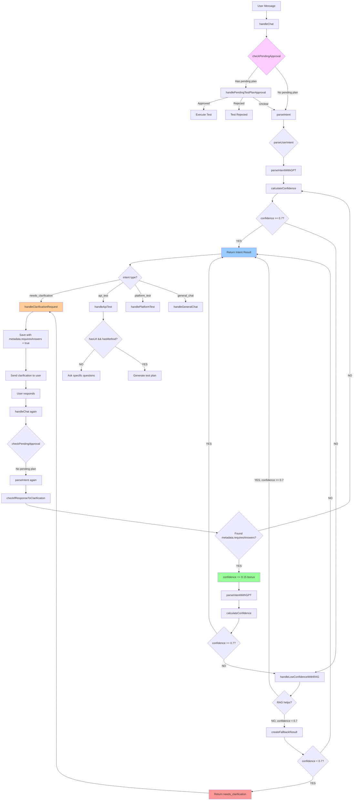

# Needs Clarification Flow Diagram

## 📊 Визуальная диаграмма (Mermaid)



## 🎯 Проблема старого подхода (РЕШЕНА)

### ❌ Старый Flow (ПРОБЛЕМА):

```
User Message
    ↓
[parseIntent] → confidence: 0.5 (НИЗКИЙ!)
    ↓
[routeToHandler] → УГАДЫВАЕТ intent (api_test или platform_test)
    ↓
[handleApiTest/handlePlatformTest]
    ↓
Проверка: hasUrl? hasMethod? hasScope?
    ↓
❌ НЕТ → requestMissingInformation()
    ↓
✅ Вопросы пользователю
```

**Проблема:** Система уже решила что это `api_test`, хотя confidence был низкий!

---

## ✅ Новый Flow (РЕШЕНИЕ):

### Flow 1: Низкий Confidence → Clarification

```
User Message: "test this"
    ↓
[handleChat]
    ↓
[checkPendingApproval] → Нет pending plan
    ↓
[parseIntent]
    ↓
[parseUserIntent]
    ↓
[parseIntentWithGPT] → intent: "api_test", confidence: 0.45
    ↓
[calculateConfidence] → confidence: 0.45
    ↓
[handleHighConfidenceResult] → confidence < 0.7 → return null
    ↓
[handleLowConfidenceWithRAG]
    ↓
[RAG fallback] → confidence все еще < 0.7
    ↓
[createFallbackResult] → confidence < 0.7
    ↓
✅ RETURN: {
    intent: "needs_clarification",
    confidence: 0.45,
    clarificationQuestion: "I'd like to help you test an API endpoint...",
    possibleIntents: ["api_test", "platform_test"]
}
    ↓
[routeToHandler] → intent === "needs_clarification"
    ↓
[handleClarificationRequest]
    ↓
Сохраняет в историю с metadata:
{
    role: "ai",
    content: "❓ I'd like to help...",
    metadata: {
        requiresAnswers: true,  ← КЛЮЧЕВОЙ ФЛАГ
        needsMoreInfo: true,
        possibleIntents: ["api_test", "platform_test"]
    }
}
    ↓
✅ Отправляет clarification пользователю
```

### Flow 2: Ответ на Clarification

```
User Message: "https://api.example.com/users"
    ↓
[handleChat]
    ↓
[checkPendingApproval] → Нет pending plan
    ↓
[parseIntent]
    ↓
[parseUserIntent]
    ↓
[checkIfResponseToClarification] → Проверяет историю
    ↓
Находит последнее AI сообщение:
    metadata.requiresAnswers === true ✅
    ↓
✅ isResponseToClarification = TRUE
    ↓
[parseIntentWithGPT] → intent: "api_test", confidence: 0.65
    ↓
[calculateConfidence] → confidence: 0.65
    ↓
🎁 БОНУС: confidence += 0.15 → confidence: 0.80
    ↓
[handleHighConfidenceResult] → confidence >= 0.7 ✅
    ↓
✅ RETURN: {
    intent: "api_test",
    confidence: 0.80,
    apiUrl: "https://api.example.com/users"
}
    ↓
[routeToHandler] → intent === "api_test"
    ↓
[handleApiTest] → Проверяет hasUrl, hasMethod
    ↓
✅ hasUrl: true, hasMethod: false
    ↓
Спрашивает только метод (не URL, т.к. уже есть)
```

---

## 📊 Сравнение: Старый vs Новый

### Старый подход (ПРОБЛЕМА):

```
┌─────────────────────────────────────────┐
│  User: "test this"                       │
└─────────────────────────────────────────┘
              ↓
┌─────────────────────────────────────────┐
│  parseIntent()                          │
│  confidence: 0.5 (НИЗКИЙ!)              │
└─────────────────────────────────────────┘
              ↓
┌─────────────────────────────────────────┐
│  ❌ УГАДЫВАЕТ: api_test                 │
│  (хотя confidence низкий!)              │
└─────────────────────────────────────────┘
              ↓
┌─────────────────────────────────────────┐
│  handleApiTest()                        │
│  Проверка: hasUrl? → NO                 │
└─────────────────────────────────────────┘
              ↓
┌─────────────────────────────────────────┐
│  ✅ Спрашивает URL                     │
└─────────────────────────────────────────┘
```

**Проблема:** Система уже решила что это `api_test`, хотя была неуверена!

---

### Новый подход (РЕШЕНИЕ):

```
┌─────────────────────────────────────────┐
│  User: "test this"                       │
└─────────────────────────────────────────┘
              ↓
┌─────────────────────────────────────────┐
│  parseIntent()                          │
│  confidence: 0.5 (НИЗКИЙ!)              │
└─────────────────────────────────────────┘
              ↓
┌─────────────────────────────────────────┐
│  ✅ needs_clarification                 │
│  (НЕ угадывает!)                        │
└─────────────────────────────────────────┘
              ↓
┌─────────────────────────────────────────┐
│  handleClarificationRequest()           │
│  Сохраняет с metadata.requiresAnswers   │
└─────────────────────────────────────────┘
              ↓
┌─────────────────────────────────────────┐
│  ✅ Спрашивает: "What do you want to    │
│     test? API or web page?"             │
└─────────────────────────────────────────┘
              ↓
┌─────────────────────────────────────────┐
│  User: "https://api.example.com/users"   │
└─────────────────────────────────────────┘
              ↓
┌─────────────────────────────────────────┐
│  parseIntent()                          │
│  checkIfResponseToClarification() ✅    │
│  confidence: 0.65 + 0.15 bonus = 0.80  │
└─────────────────────────────────────────┘
              ↓
┌─────────────────────────────────────────┐
│  ✅ api_test (высокий confidence!)      │
└─────────────────────────────────────────┘
```

**Решение:** Система НЕ угадывает, а спрашивает ДО определения intent!

---

## 🔍 Детальный Flow: Detection через Metadata

### Как работает `checkIfResponseToClarification`:

```
┌─────────────────────────────────────────────┐
│  checkIfResponseToClarification(context)    │
└─────────────────────────────────────────────┘
              ↓
┌─────────────────────────────────────────────┐
│  Получает chatHistory из context            │
└─────────────────────────────────────────────┘
              ↓
┌─────────────────────────────────────────────┐
│  Находит последнее AI сообщение             │
└─────────────────────────────────────────────┘
              ↓
┌─────────────────────────────────────────────┐
│  Проверка 1: metadata.requiresAnswers?     │
│  ✅ TRUE → return true                     │
│  ❌ FALSE → дальше                         │
└─────────────────────────────────────────────┘
              ↓
┌─────────────────────────────────────────────┐
│  Проверка 2: metadata.questions?           │
│  ✅ Array.length > 0 → return true          │
│  ❌ FALSE → дальше                          │
└─────────────────────────────────────────────┘
              ↓
┌─────────────────────────────────────────────┐
│  Проверка 3: metadata.needsMoreInfo?       │
│  ✅ TRUE → return true                     │
│  ❌ FALSE → дальше                         │
└─────────────────────────────────────────────┘
              ↓
┌─────────────────────────────────────────────┐
│  Fallback: Проверка структуры вопроса       │
│  (❓, 📋, 📡, 🌐 + "?" или "provide")      │
│  ✅ TRUE → return true                     │
│  ❌ FALSE → return false                   │
└─────────────────────────────────────────────┘
```

---

## 🎯 Ключевые улучшения

### 1. ✅ Раннее обнаружение проблемы

**Было:**

```
parseIntent → угадывает → handleApiTest → проверяет → спрашивает
```

**Стало:**

```
parseIntent → needs_clarification → спрашивает → parseIntent → уверенно определяет
```

### 2. ✅ Metadata-based detection (не хардкод)

**Было:**

```typescript
// Хардкод текстов
const markers = ['❓', 'clarification', 'not entirely sure', ...]
```

**Стало:**

```typescript
// Проверка metadata
if (metadata.requiresAnswers === true) return true;
if (metadata.questions?.length > 0) return true;
```

### 3. ✅ Confidence bonus для ответов

**Было:**

```
User отвечает → confidence: 0.65 → все еще < 0.7 → снова clarification
```

**Стало:**

```
User отвечает → confidence: 0.65 + 0.15 bonus = 0.80 → >= 0.7 → выполняет intent
```

### 4. ✅ Совместимость со старым кодом

- ✅ Работает с новым `needs_clarification`
- ✅ Работает со старым `requestMissingInformation` (metadata.questions)
- ✅ Fallback на структурированные вопросы

---

## 📈 Сравнительная таблица

| Аспект                                    | Старый подход ❌      | Новый подход ✅                    |
| ----------------------------------------- | --------------------- | ---------------------------------- |
| **Когда спрашивает?**                     | После парсинга intent | До парсинга intent                 |
| **Что происходит при низком confidence?** | Угадывает intent      | Возвращает `needs_clarification`   |
| **Detection метод**                       | Нет (не было нужно)   | Metadata-based (не хардкод)        |
| **Confidence bonus**                      | Нет                   | +0.15 для ответов на clarification |
| **Совместимость**                         | Только старый код     | Старый + новый код                 |
| **Точность**                              | Низкая (угадывает)    | Высокая (спрашивает)               |

## 📈 Результат

### Проблема решена:

❌ **Было:** Система угадывала intent при низком confidence
✅ **Стало:** Система спрашивает ДО определения intent

❌ **Было:** Хардкод текстов для detection
✅ **Стало:** Metadata-based detection

❌ **Было:** Ответы на clarification снова приводили к clarification
✅ **Стало:** Confidence bonus помогает правильно определить intent

---

## 🔄 Полный цикл примера

```
1. User: "test this"
   → checkPendingApproval() → нет pending plan
   → parseIntent() → confidence: 0.45
   → needs_clarification
   → AI: "❓ What do you want to test?"

2. User: "API endpoint"
   → parseIntent() → confidence: 0.60
   → checkIfResponseToClarification() → TRUE
   → confidence: 0.60 + 0.15 = 0.75
   → needs_clarification (все еще < 0.7, но близко)
   → AI: "🌐 What is the API endpoint URL?"

3. User: "https://api.example.com/users"
   → parseIntent() → confidence: 0.70
   → checkIfResponseToClarification() → TRUE
   → confidence: 0.70 + 0.15 = 0.85
   → api_test ✅
   → handleApiTest() → проверяет hasMethod
   → AI: "📡 Which HTTP method? (GET, POST, ...)"

4. User: "GET"
   → parseIntent() → confidence: 0.90
   → api_test ✅
   → handleApiTest() → все данные есть
   → Генерирует test plan
```

---

## ✅ Итог

**Проблема закрыта:**

- ✅ Система НЕ угадывает при низком confidence
- ✅ Спрашивает ДО определения intent
- ✅ Использует metadata вместо хардкода
- ✅ Дает bonus confidence для ответов на clarification
- ✅ Совместима со старым кодом
